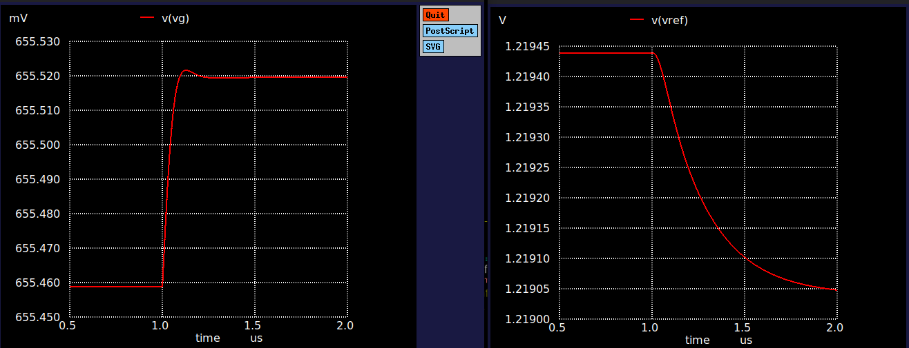
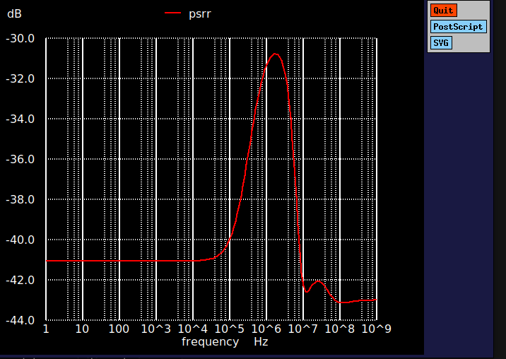

# 1.2 V Bandgap Voltage Reference — SkyWater SKY130

A transistor-level bandgap reference designed and verified in the open-source SKY130 PDK using xschem and ngspice. Built as the voltage reference for a future 10-bit SAR ADC.

## Results

| Parameter | Result | Conditions |
|---|---|---|
| VREF | 1.219 V | tt, 27 °C |
| Temperature coefficient | 14.2 ppm/°C typical, ≤ 24.9 ppm/°C worst | −40 to 125 °C, 25 process/resistor corners |
| Process spread | ±0.35% | 25 corners |
| Mismatch spread | ±1.57% (3σ) | 200-run Monte Carlo |
| Supply range | 1.8 V ± 10% | all corners and temperatures |
| Line regulation | ≤ 11.8 mV/V | worst case |
| PSRR | −41 dB (DC), −30.8 dB worst | tt, 27 °C |
| Startup | ≤ 82 µs, overshoot ≤ 5.8 mV | 7 corners × 3 temperatures |
| Phase margin | ~65–70° | closed-loop step response |

## Design

Three-branch PNP bandgap: a PMOS current mirror feeds three branches, a 5-transistor OTA (NMOS low-Vt input pair) forces two branches to equal voltage, and the third branch sums a falling VBE with an amplified PTAT voltage. Also includes a startup circuit, a 4.5 pF MIM compensation capacitor and a 5 pF output filter capacitor. Resistors are matched `res_xhigh_po` unit arrays with a trim segment.

Every device size was derived from a requirement (gain, offset, input common-mode range, headroom) and then confirmed or corrected in simulation.

## Verification highlights

- **Startup bug masked by leakage.** Startup tests passed, but cold startup was slow and insensitive to the startup transistor's size. Probing device currents showed the startup transistor was disconnected; the circuit had been starting on leakage alone. After the fix, startup follows the supply ramp at every corner.
- **Supply headroom.** A VDD sweep failed 1.8 V ± 10% at the sf/125 °C corner. Comparing Vds to Vdsat per device traced it to the mirror and OTA output stage; widening them 4× fixed it.
- **Mismatch.** Monte Carlo initially gave σ = 15 mV. Breaking the error into its contributors (OTA offset, mirror ratio, resistor ratio, ΔVBE) and fixing the largest ones cut it to 6.37 mV.
- **Stability.** A small-signal step test found ~22° phase margin; a compensation cap from the gate node to VDD raised it to ~65–70°.


*Step response: 10 nA current step into the gate node (left) and the resulting VREF response (right).*


*Power-supply rejection versus frequency.*

## Files

| File | Contents |
|---|---|
| `bandgap.sch` | Final bandgap design |
| `bandgap_ota.sch`, `bandgap_ota.sym` | 5T OTA and its symbol |
| `bandgap_ideal.sch` | Baseline with an ideal amplifier, used for comparison |
| `ota_tb.sch` | Open-loop OTA testbench |
| `tb_pnp.sch` | PNP VBE characterization |
| `design_report.pdf` | Full design and verification write-up |

## Running it

Uses the [IIC-OSIC-TOOLS](https://github.com/iic-jku/iic-osic-tools) container. Inside it:

```
iic-pdk sky130A
xschem bandgap.sch
```

Then press **Netlist** and **Simulate**. Simulation commands are in the SIMCOMMANDS block in each schematic.

Full write-up: [design report](design_report.pdf)
